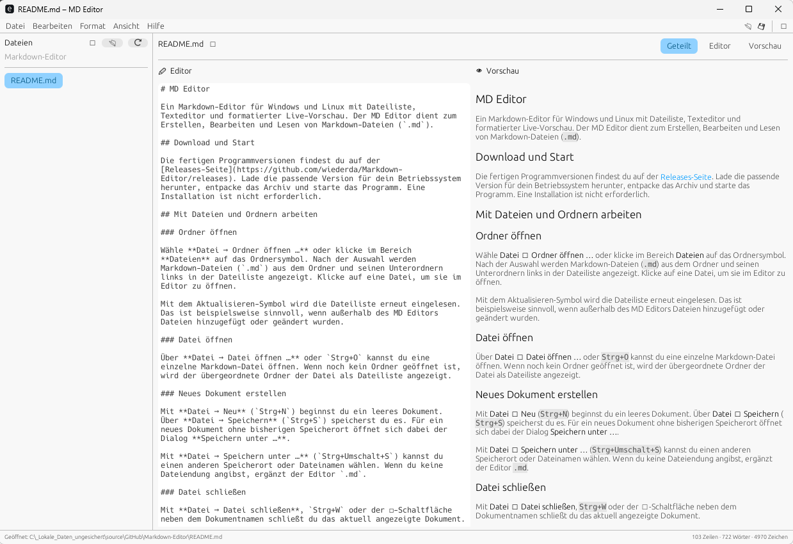

# MD Editor

Ein Markdown- und HTML-Editor für Windows und Linux mit Dateiliste, Tabs, Texteditor und formatierter Live-Vorschau. Der MD Editor dient zum Erstellen, Bearbeiten und Lesen von Markdown-Dateien (`.md`) und HTML-Dateien (`.html`, `.htm`).



## Download und Start

Die fertigen Programmversionen findest du auf der [Releases-Seite](https://github.com/wiederda/Markdown-Editor/releases). Lade die passende Version für dein Betriebssystem herunter, entpacke das Archiv und starte das Programm. Eine Installation ist nicht erforderlich.

Dateien lassen sich auch direkt aus dem Explorer heraus öffnen: Mit **Datei → Mit „Öffnen mit“ verknüpfen** registriert der MD Editor sich einmalig für Markdown- und HTML-Dateien, danach erscheinen diese im Kontextmenü **Öffnen mit**. Zusätzlich können Dateien per Drag & Drop in das Fenster gezogen werden – auch mehrere Dateien gleichzeitig.

## Mit Dateien und Ordnern arbeiten

### Ordner öffnen

Wähle **Datei → Ordner öffnen …** oder klicke im Bereich **Dateien** auf das Ordnersymbol. Nach der Auswahl werden Markdown- und HTML-Dateien aus dem Ordner und seinen Unterordnern links in der Dateiliste angezeigt. Klicke auf eine Datei, um sie im Editor zu öffnen.

Mit dem Aktualisieren-Symbol wird die Dateiliste erneut eingelesen. Das ist beispielsweise sinnvoll, wenn außerhalb des MD Editors Dateien hinzugefügt oder geändert wurden.

### Datei öffnen

Über **Datei → Datei öffnen …** oder `Strg+O` kannst du eine einzelne Datei öffnen. Wenn noch kein Ordner geöffnet ist, wird der übergeordnete Ordner der Datei als Dateiliste angezeigt.

### Tabs
Jede geöffnete Datei erscheint in einem eigenen Tab. Klicke auf einen Tab, um das Dokument zu wechseln, oder auf `×`, um ihn zu schließen. Du kannst auch mehrere Markdown-Dateien gleichzeitig auf das Programmfenster ziehen.

Geöffnete Dokumente werden in einer Tab-Leiste verwaltet. Jeder Tab zeigt den Dateityp (`MD` oder `HTML`), den Namen und einen Punkt bei ungespeicherten Änderungen. Über einen Rechtsklick auf einen Tab erreichst du **Speichern**, **Schließen** und **Andere schließen**. Mit `Strg+Tab` und `Strg+Umschalt+Tab` wechselst du zwischen den Tabs, mit dem +-Button neben der Tab-Leiste öffnest du ein neues Dokument.

### Neue Dokumente erstellen

Mit **Datei → Neu (Markdown)** (`Strg+N`) oder **Datei → Neu (HTML)** beginnst du ein leeres Dokument. Über **Datei → Speichern** (`Strg+S`) speicherst du es. Für ein neues Dokument ohne bisherigen Speicherort öffnet sich dabei der Dialog **Speichern unter …**.

Mit **Datei → Speichern unter …** (`Strg+Umschalt+S`) kannst du einen anderen Speicherort oder Dateinamen wählen. Wenn du keine Dateiendung angibst, ergänzt der Editor `.md` beziehungsweise `.html`.

### Datei schließen

Mit **Datei → Datei schließen**, `Strg+W` oder der ×-Schaltfläche neben dem Dokumentnamen schließt du das aktuell angezeigte Dokument.

- Das Dokument wird aus Editor und Vorschau entfernt.
- Der Eintrag bleibt in der Dateiliste erhalten, solange der zugehörige Ordner geöffnet ist.
- Die Datei bleibt auf der Festplatte erhalten und wird nicht gelöscht.
- Der geöffnete Ordner und andere Dateien in der Dateiliste bleiben erhalten.

### Ordner schließen

Mit **Datei → Ordner schließen** oder dem ×-Symbol im Kopf der Dateiliste schließt du den aktuell geöffneten Ordner.

- Die Dateiliste wird geleert und der Ordner wird aus der Anwendung entfernt.
- Das aktuell angezeigte Dokument wird ebenfalls geschlossen.
- Der Editor kehrt zur Ansicht ohne geöffneten Ordner zurück.
- **Weder der Ordner noch darin enthaltene Dateien werden von der Festplatte gelöscht.**

Das Öffnen eines anderen Ordners ersetzt den bisher geöffneten Ordner in der Anwendung.

### Neu laden

Mit **Datei → Neu laden** (`F5`) liest du die Datei erneut von der Festplatte ein. Das ist hilfreich, wenn eine Datei in einem anderen Programm geändert wurde. Die Option steht nur zur Verfügung, wenn das Dokument keine ungespeicherten Änderungen enthält.

### Speichern und ungespeicherte Änderungen

Ein Punkt neben dem Dokumentnamen beziehungsweise der Hinweis **ungespeichert** zeigt an, dass Änderungen noch nicht gespeichert sind. Beim Schließen eines Dokuments, eines Ordners oder des Programms fragt der MD Editor nach, ob du die Änderungen **Speichern**, **Verwerfen** oder den Vorgang **Abbrechen** möchtest.

## Editor und Vorschau

Über **Ansicht** oder die Schaltflächen oberhalb des Dokuments kannst du zwischen drei Darstellungen wechseln:

- **Geteilt:** Editor und formatierte Vorschau nebeneinander.
- **Nur Editor:** Bearbeitung ohne Vorschau.
- **Nur Vorschau:** Formatierte Darstellung des Dokuments.

Die Vorschau aktualisiert sich während der Bearbeitung. Bei Markdown-Dokumenten wird die gerenderte Darstellung angezeigt, bei HTML-Dokumenten eine formatierte Ansicht inklusive CSS und Bildern. Relative Pfade zu Bildern und Stylesheets werden dabei ausgehend vom Ordner der geöffneten Datei aufgelöst. Die Scrollpositionen von Editor und Vorschau lassen sich synchronisieren (**Ansicht → Synchronisiertes Scrollen**), und die Bereiche können durch Ziehen ihrer Trennlinien in der Größe angepasst werden.

Über **Ansicht → Dateiliste** lässt sich der linke Dateibereich ein- und ausblenden.

## Bilder in der Vorschau

Bilder werden direkt in der Vorschau angezeigt. Bei relativen Bildpfaden wird der Ordner der geöffneten Datei als Ausgangspunkt verwendet. Beispiel:

```markdown

```

Unterstützt werden PNG-, JPEG-, GIF-, WebP-, BMP- und TIFF-Bilder.

## Markdown formatieren

Die Formatierungen findest du im Menü **Format**. Sie werden an der Cursorposition oder auf den markierten Text angewendet. Verfügbar sind:

- Fett, kursiv und durchgestrichen
- Inline-Code und Codeblock
- Überschriften der Ebenen 1 bis 3
- Aufzählungslisten und nummerierte Listen
- Zitate
- Tabellen
- Links und Bilder
- Trennlinien

Die Formatierungen sind außerdem über das Kontextmenü erreichbar, das du mit einem Rechtsklick im Editor öffnest.

## HTML bearbeiten

HTML-Dateien öffnen und bearbeiten Sie wie Markdown-Dokumente, mit Syntaxhervorhebung für Tags, Attribute und Kommentare, Zeilennummern, automatischer Einrückung und Suchen & Ersetzen. Mit **Format → HTML formatieren** (`Strg+Umschalt+F`) wird die Einrückung des gesamten Dokuments vereinheitlicht.

## Suchen und Ersetzen

Über **Bearbeiten → Suchen …** (`Strg+F`) beziehungsweise **Bearbeiten → Ersetzen …** (`Strg+H`) öffnest du die Suchleiste. Sie bietet Weitersuchen, Ersetzen des aktuellen Treffers, Alle ersetzen und die Option, die Groß- und Kleinschreibung zu beachten.

## HTML exportieren

Mit **Datei → HTML exportieren …** wandelst du das aktuelle Markdown-Dokument in eine eigenständige HTML-Datei um. Du wählst dabei den Titel, ob ein vollständiges HTML-Dokument (mit Head und Body) erzeugt wird und welches Stylesheet verwendet wird: kein Stylesheet, der eingebaute Standard-Stil oder eine eigene CSS-Datei, die als Verweis in die Ausgabe geschrieben wird.

Markdown-Syntax wird im Editor farblich hervorgehoben. Mit **Bearbeiten → Suchen und Ersetzen …** oder `Strg+F` kannst du im aktiven Dokument weitersuchen und alle passenden Stellen ersetzen.

Unter Windows kannst du in **Datei** den Explorer-Eintrag **Im Explorer: Mit MD Editor öffnen** ein- oder ausschalten. Der benutzerspezifische Eintrag wird beim nächsten Programmstart auf den aktuellen Speicherort aktualisiert.

## Weitere Funktionen

- **Zuletzt geöffnet:** Unter **Datei → Zuletzt geöffnet** findest du bis zu zehn zuletzt geöffnete Dateien.
- **Design:** Über die Schaltfläche rechts oben wechselst du zwischen System, Hell und Dunkel.
- **Statusleiste:** Am unteren Fensterrand werden Zeilen, Wörter und Zeichen des aktuellen Dokuments angezeigt.
- **Vollbild:** Mit `F11` wechselst du in den Vollbildmodus und zurück.

## Tastenkürzel

| Tastenkürzel | Funktion |
| --- | --- |
| `Strg+N` | Neues Markdown-Dokument |
| `Strg+O` | Datei öffnen |
| `Strg+S` | Speichern |
| `Strg+Umschalt+S` | Speichern unter … |
| `Strg+W` | Datei schließen |
| `Strg+Tab` | Nächster Tab |
| `Strg+Umschalt+Tab` | Vorheriger Tab |
| `Strg+B` | Fett |
| `Strg+I` | Kursiv |
| `Strg+K` | Link einfügen |
| `Strg+1` | Überschrift 1 |
| `Strg+2` | Überschrift 2 |
| `Strg+3` | Überschrift 3 |
| `Strg+F` | Suchen |
| `Strg+H` | Suchen und Ersetzen |
| `Strg+Z` | Rückgängig |
| `Strg+Umschalt+Z` | Wiederholen |
| `Strg+Umschalt+F` | HTML formatieren |
| `F5` | Datei neu laden |
| `F11` | Vollbild umschalten |

## Hilfe

Über **Hilfe → Tastenkürzel** kannst du die Tastenkürzel direkt im Programm anzeigen. Unter **Hilfe → Über MD Editor** findest du die Versionsinformationen.
