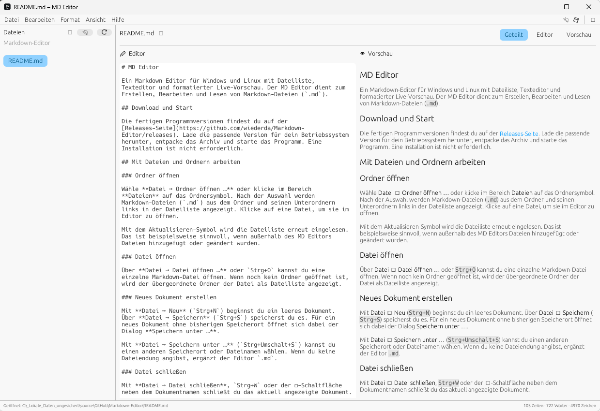

# MD Editor

Ein Markdown-Editor für Windows und Linux mit Dateiliste, Texteditor und formatierter Live-Vorschau. Der MD Editor dient zum Erstellen, Bearbeiten und Lesen von Markdown-Dateien (`.md`).



## Download und Start

Die fertigen Programmversionen findest du auf der [Releases-Seite](https://github.com/wiederda/Markdown-Editor/releases). Lade die passende Version für dein Betriebssystem herunter, entpacke das Archiv und starte das Programm. Eine Installation ist nicht erforderlich.

## Mit Dateien und Ordnern arbeiten

### Ordner öffnen

Wähle **Datei → Ordner öffnen …** oder klicke im Bereich **Dateien** auf das Ordnersymbol. Nach der Auswahl werden Markdown-Dateien (`.md`) aus dem Ordner und seinen Unterordnern links in der Dateiliste angezeigt. Klicke auf eine Datei, um sie im Editor zu öffnen.

Mit dem Aktualisieren-Symbol wird die Dateiliste erneut eingelesen. Das ist beispielsweise sinnvoll, wenn außerhalb des MD Editors Dateien hinzugefügt oder geändert wurden.

### Datei öffnen

Über **Datei → Datei öffnen …** oder `Strg+O` kannst du eine einzelne Markdown-Datei öffnen. Wenn noch kein Ordner geöffnet ist, wird der übergeordnete Ordner der Datei als Dateiliste angezeigt.

### Neues Dokument erstellen

Mit **Datei → Neu** (`Strg+N`) beginnst du ein leeres Dokument. Über **Datei → Speichern** (`Strg+S`) speicherst du es. Für ein neues Dokument ohne bisherigen Speicherort öffnet sich dabei der Dialog **Speichern unter …**.

Mit **Datei → Speichern unter …** (`Strg+Umschalt+S`) kannst du einen anderen Speicherort oder Dateinamen wählen. Wenn du keine Dateiendung angibst, ergänzt der Editor `.md`.

### Datei schließen

Mit **Datei → Datei schließen**, `Strg+W` oder der ✕-Schaltfläche neben dem Dokumentnamen schließt du das aktuell angezeigte Dokument.

- Das Dokument wird aus Editor und Vorschau entfernt.
- Der Eintrag bleibt in der Dateiliste erhalten, solange der zugehörige Ordner geöffnet ist.
- Die Datei bleibt auf der Festplatte erhalten und wird nicht gelöscht.
- Der geöffnete Ordner und andere Dateien in der Dateiliste bleiben erhalten.

### Ordner schließen

Mit **Datei → Ordner schließen** oder dem ✕-Symbol im Kopf der Dateiliste schließt du den aktuell geöffneten Ordner.

- Die Dateiliste wird geleert und der Ordner wird aus der Anwendung entfernt.
- Das aktuell angezeigte Dokument wird ebenfalls geschlossen.
- Der Editor kehrt zur Ansicht ohne geöffneten Ordner zurück.
- **Weder der Ordner noch darin enthaltene Dateien werden von der Festplatte gelöscht.**

Das Öffnen eines anderen Ordners ersetzt den bisher geöffneten Ordner in der Anwendung.

### Speichern

Ein Punkt neben dem Dokumentnamen beziehungsweise der Hinweis **ungespeichert** zeigt an, dass Änderungen noch nicht gespeichert sind. Der MD Editor speichert Änderungen beim Wechsel zu einer anderen Datei sowie beim Schließen einer Datei oder eines Ordners automatisch. Beim Beenden des Programms werden Änderungen an einer bereits gespeicherten Datei ebenfalls gesichert.

## Editor und Vorschau

Über **Ansicht** oder die Schaltflächen oberhalb des Dokuments kannst du zwischen drei Darstellungen wechseln:

- **Geteilt:** Editor und formatierte Vorschau nebeneinander.
- **Nur Editor:** Bearbeitung ohne Vorschau.
- **Nur Vorschau:** Formatierte Darstellung des Markdown-Dokuments.

Über **Ansicht → Dateiliste** lässt sich der linke Dateibereich ein- und ausblenden. Die Bereiche können durch Ziehen ihrer Trennlinien in der Größe angepasst werden.

## Bilder in der Vorschau

Bilder werden direkt in der Vorschau angezeigt. Bei relativen Bildpfaden wird der Ordner der geöffneten Markdown-Datei als Ausgangspunkt verwendet. Beispiel:

```markdown

```

Unterstützt werden PNG-, JPEG-, GIF-, WebP-, BMP- und TIFF-Bilder.

## Markdown formatieren

Die Formatierungen findest du im Menü **Format**. Sie werden an der Cursorposition oder auf den markierten Text angewendet. Verfügbar sind:

- Fett, kursiv und durchgestrichen
- Inline-Code und Codeblock
- Überschriften der Ebenen 1 bis 3
- Aufzählungslisten und nummerierte Listen
- Zitate
- Links
- Trennlinien

Die Formatierungen sind außerdem über das Kontextmenü erreichbar, das du mit einem Rechtsklick im Editor öffnest.

## Weitere Funktionen

- **Zuletzt geöffnet:** Unter **Datei → Zuletzt geöffnet** findest du bis zu zehn zuletzt geöffnete Dateien.
- **Design:** Über das Design-Symbol wechselst du zwischen System, Hell und Dunkel.
- **Statusleiste:** Am unteren Fensterrand werden Zeilen, Wörter und Zeichen des aktuellen Dokuments angezeigt.
- **Vollbild:** Mit `F11` wechselst du in den Vollbildmodus und zurück.

## Tastenkürzel

| Tastenkürzel | Funktion |
| --- | --- |
| `Strg+N` | Neues Dokument |
| `Strg+O` | Datei öffnen |
| `Strg+S` | Speichern |
| `Strg+Umschalt+S` | Speichern unter … |
| `Strg+W` | Datei schließen |
| `Strg+B` | Fett |
| `Strg+I` | Kursiv |
| `Strg+K` | Link einfügen |
| `Strg+1` | Überschrift 1 |
| `Strg+2` | Überschrift 2 |
| `Strg+3` | Überschrift 3 |
| `Strg+Z` | Rückgängig |
| `Strg+Umschalt+Z` | Wiederholen |
| `F11` | Vollbild umschalten |

## Hilfe

Über **Hilfe → Tastenkürzel** kannst du die Tastenkürzel direkt im Programm anzeigen. Unter **Hilfe → Über MD Editor** findest du die Versionsinformationen.
